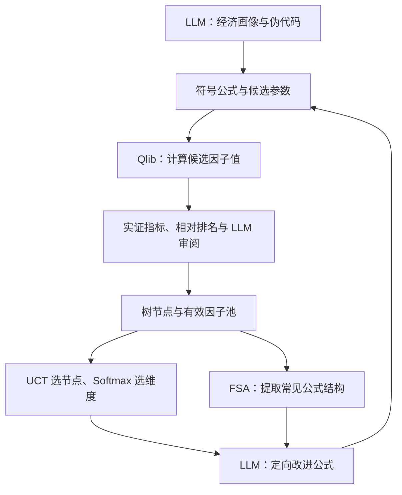
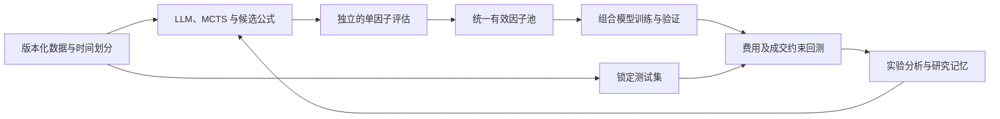

# Alpha-Jungle-MCTS：论文与当前项目实现对照

> **形态**：Single-Agent ｜ **应用**：Alpha 因子挖掘 ｜ **机制**：搜索策略、评测与可复现性
>
> 本报告回答：项目怎样做到只搜索公式、哪些简化会影响效果、怎样补成完整系统。

审查对象是当前工作区代码，最近提交为 `cab5d91f3cb834c3810811142407047bd2fef7ff`（2025-07-23）。主依据是用户提供的 9 页 AAAI 2026 正式论文，附录细节参考 [arXiv 扩展版](https://arxiv.org/html/2505.11122v2)。仓库内 `Artical` 的旧版转录只作辅助，不能代替用户提供的 PDF。对照的是论文公开描述及伪代码；本次没有取得和审计作者的完整实验源代码。

结论：**这是一个具备论文主要搜索骨架、但评估和状态传递存在实质缺陷的公式因子挖掘原型。当前目录尚不能作为论文完整复现，也没有完成策略研究闭环。** “只生成公式”本身是合理的设计边界；更值得先修的是奖励是否正确、实验是否隔离、搜索状态是否一致。

本次没有修改业务代码，没有调用付费 LLM API，没有启动真实市场搜索。静态审查之外，使用合成面板数据和受控依赖运行了隔离探针。它们证明的是组件行为，不是实际投资收益。

## 1. 论文的核心增量及适用边界

论文把一个公式因子当作一个可立即评估的搜索节点。LLM 利用市场常识提出公式和改进建议，MCTS 根据实证反馈决定继续改哪个节点、改善哪个维度。对有效因子池挖掘常见子树，再把这些结构反馈给 LLM，减少反复生成近似公式。

最重要的增量是：**把可解释的公式生成，与可以逐节点计算的金融反馈组成有记忆的树搜索。** 它没有训练一个新的大模型，MCTS 中的 backpropagation 也只是更新树统计量。

论文主文的回报是五维得分均值，沿路径采用 `max` 回传；评估直接使用因子表现，跳过传统 MCTS 的随机 rollout。论文最终实验另有因子组合模型和交易回测，因此“公式搜索完整”和“整篇实验完整”是两个验收层级。

## 2. 项目怎样实现“只构建因子公式然后进行搜索”

### 2.1 固定一个公式语言，让 Qlib 执行

`llm/prompts.py:11` 限定六个量价字段：`$open,$close,$high,$low,$volume,$vwap`；下一行列出 `Ref,Mean,Std,Sum,Min,Max,Delta,Corr,Cov,Rank,Log,Abs,Sign,Med,Mad,Skew,Kurt` 等算子。

LLM 输出这个语言里的表达式字符串，而不是完整 Python 策略程序。例如：

```text
Rank(($close - Ref($close, w1)) / Std($close, w2), w3)
```

公式的执行器已经由 Qlib 提供，项目调用 `D.features(universe, [formula], ...)` 得到每个交易日、每只股票的因子值。这里的 `Rank(expr,N)` 是 Qlib 的时间窗口排名；评估函数里按 `datetime` 分组得到的横截面排名是另一项操作，使用时需要区分。

### 2.2 先生成画像，再生成符号公式和参数候选

`llm/client.py:323` 的 `generate_initial()` 先生成名称、描述和伪代码，再生成包含 `formula / parameters / candidates` 的结构。它评估 LLM 提供的几组参数，保留平均得分最高的一组。

这不是通过梯度学习参数，也不是遍历所有参数组合。公式结构由 LLM 提供，参数搜索只覆盖 LLM 给出的有限候选。**符号参数和三组候选是论文附录本来就有的设计，不应当误判为本项目独有的偷简化。**

### 2.3 树节点是一个完整候选，边是一次改进

`mcts/node.py:28` 保存公式、参数信息、五维得分、父子关系、访问次数和改进历史。`mcts/search.py:221` 用 UCT 在已发现的候选间选择下一步改谁；virtual action 允许继续扩展内部节点。

`select_dimension()` 用 `softmax((e_max-E)/T)` 偏向低分维度。选完维度，LLM 生成新画像和新公式，再评估新公式，形成一个子节点。树上的边对应一次完整公式的修改，而不是依次补齐一个表达式 token。

### 2.4 计算实证分数，再更新树

`evaluation/qlib_evaluator.py:58` 获取因子及未来收益，计算 RankIC、RankICIR、排名变动、多样性和一个 IS/OOS 衰减指标。`ComprehensiveEvaluator` 将前几个指标转成相对排名分数，并用 LLM 的公式审阅分数覆盖最终 `Overfitting` 维度。

`simulate()` 这个函数名称容易误导：它没有模拟未来市场路径，也没有生成新的 rollout。它主要计算均分、处理入库和奖励惩罚。`node.backpropagate()` 将奖励的最大值沿祖先链回传。



可以把它理解成改配方：LLM 写配方，Qlib 实际试做，评估器评分，MCTS 决定下次改哪张配方。这个比喻里，如果评分器把“更稳定”评成低分，搜索越勤奋也可能离目标越远。

## 3. 与论文逐项对照

| 环节 | 论文公开描述 | 当前项目 | 判断 |
| --- | --- | --- | --- |
| 候选形式 | 显式数学公式 | Qlib 表达式字符串 | 核心方向一致 |
| 两步生成 | 概念画像，再构建公式 | 两次 LLM 生成 | 已实现骨架 |
| 参数候选 | 符号参数，三组候选，评估选优 | 相同思路 | 合理复现，评估副作用有问题 |
| UCT 与回传 | 虚拟动作，子树最大奖励 | 均有实现 | 基本结构一致 |
| 虚拟访问次数 | `1 + 子节点数` | `子节点数` | 数值差异，扩展偏好不同 |
| 多维改进 | 根据弱项概率选择维度 | 相同公式，但每维最多扩展两次 | 新增了搜索限制 |
| 公式校验 | 非法公式获得反馈后迭代修正 | 校验版本被后面的同名函数覆盖 | 明确实现缺陷 |
| 有效因子池 | 实证门槛，论文附录还给出绝对指标门槛 | 排名池与搜索入库池使用两套规则 | 两套池子不一致 |
| FSA 数据源 | 有效因子池 | 成功生成、评估的扩展节点，包含未入库节点 | 偏离论文 |
| FSA 参数抽象 | 不同窗口统一为结构占位符 | 只统一数字常量，具名参数未统一 | 符号公式路径下失效一部分 |
| FSA 闭合判断 | 基于树结构的 closed root gene | 字符串包含关系近似 | 近似实现 |
| few-shot | 按相关性和目标表现选例 | 有选择器，但多数子节点没有 `factor` 别名 | 深层分支容易退化为 zero-shot |
| 过拟合审阅 | 公式及改进轨迹 | 有 LLM 审阅，最终新节点评估缺少历史 | 信息不完整 |
| 预测目标 | 10 日、30 日收益 | 固定下一日收盘收益 | 实验任务不同 |
| 数据区间 | 2011–2020 训练，2021–2024/11 测试 | 默认 2020–2023 一起用于主评分 | 不能对齐论文样本外结论 |
| 市场范围 | CSI300、CSI1000 | 默认 CSI300，接口可传其他市场 | 只配置一种不等于不能扩展 |
| 搜索规模 | 1,000 / 2,000 / 3,000 个唯一候选的实验规模 | YAML 20 次，脚本会覆盖成默认 50 次，节点上限 100 | 调试规模，计数口径也不同 |
| 单树预算 | 附录 `B=3,b=1` | 一次 `run()` 基本是一棵更大的树 | 需要区分单树预算和总候选预算 |
| LLM | 正式论文主体实验 GPT-4.1，并有其他模型实验 | 默认 gpt-4o-mini | 实验变量不同，不能单凭模型名断言效果差 |
| 最终因子集 | 10 / 50 / 100 个，按 RankIR 选择 | 入库池硬编码最多 20 个，按历史五维均分淘汰 | 不能完成 50/100 因子实验 |
| 组合预测 | LightGBM、MLP，横截面 rank 标准化 | 没有对应训练和组合实验 | 缺少论文后半段 |
| 交易验证 | Top-k/drop-n、费用、AER、交易 IR | 搜索主路径只计算因子统计量 | 不能等同于策略回测 |

附录中值得复现的门槛包括 RankIC≥0.015、RankIR≥0.3、与已有因子最大相关性<0.8；原文也给出换手标准。具体换手阈值必须和其计算定义一起复现，不能把原文的数直接套到本项目的 `1-平均排名变化` 上。[扩展附录 G](https://arxiv.org/html/2505.11122v2#A7)

论文也有口径需要澄清：方法示例中的 few-shot 数量为 3，实验设置为 1；相对排名公式给出 0–1 得分，审阅 prompt 使用 0–10。做严格复现应明确最终采用哪套设置，并同步标定维度选择温度和 UCT，而不应假定论文已经消除了所有工程歧义。

## 4. 优先修复的明确缺陷

### 4.1 当前交付目录存在启动阻断

顶层 `src/mcts_llm_alpha/__init__.py:7` 导入 `.data`，`run_search.py:34` 也导入其接口，但当前目录没有这个模块。直接导入本地包得到：

```text
ModuleNotFoundError: No module named 'mcts_llm_alpha.data'
```

`cli.py:26` 还引用不存在的 `LLMInterface`，并引用未导出的 `FormulaGenerator / FormulaEvaluator`；其构造参数、`mcts.search()` 等调用也与当前 `MCTSSearch` 接口不一致。补上一个 data 目录仍不足以修好 CLI。

这说明当前交付不完整，不代表这个项目的历史版本从来没有运行过。应先统一一个真实入口，再谈真实收益实验。

### 4.2 换手奖励方向反了

`metrics/turnover.py:57` 返回 `1-avg_turnover`，即排名越稳定返回值越大。`relative_ranking.py:80` 和冷启动规则却把它当作原始换手率，认为越小越好。

隔离探针用相同的股票、日期，比较完全不变的排名和每日翻转的排名，得到：

| 候选 | calc_turnover 输出 | 冷启动 Turnover 得分 |
| --- | --- | --- |
| 排名完全不变 | 1.0000 | 1.0 / 10 |
| 排名每日翻转 | 0.5556 | 5.0 / 10 |

这是会反向引导优化的错误。应统一接口为真实 `turnover_rate`，明确越小越好；如保留稳定性指标，就更名并让排名按越大越好处理。实际持仓换手还需要单独用权重变化衡量。

### 4.3 参数试评会改变排名池，且试评时未使用真实因子仓库

`client.py:383,546` 评估参数候选时均传入空列表 `[]`。因此，参数选优时的多样性把“没有参考因子”当作前提。

与此同时，`comprehensive.py:105` 每次评估只要通过 Effectiveness 门槛，就往 `effective_repository` 添加原始指标。参数候选、重复评估、尚未正式入库的候选都可能改变下一次评估的比较基准。这个排名池既不与 MCTS 的正式入库池同步，也没有去重和同样的淘汰规则。

探针对同一组固定指标重复调用 6 次，前 5 次 Effectiveness=7，第 6 次变成 0；前 5 次评估已经把同一候选重复放入排名池。于是“选哪个参数更好”可能混入“哪个参数较早被评估”的影响。

修复方式是：评估使用一个只读的仓库快照；所有参数候选在同一个快照上比较；最终接受时统一提交一次；以规范化具体公式和参数生成唯一 ID。

### 4.4 缓存复用了依赖旧仓库的多样性

缓存键只有公式、日期和股票池，缓存结果却包括 Diversity。参数试评首先以空仓库评估，随后正式评估命中同一缓存，原来的高多样性仍会返回。

受控探针中：空库得到 Diversity=1；把相同因子加入仓库后，缓存仍返回 1；绕过缓存则返回 0。该探针用显式的仓库依赖评分 fixture 隔离了缓存机制，没有使用真实行情。

`split_date`、`ic_method` 也不在键中，因此切换评估口径可能复用不合适的结果。

建议分层：缓存因子矩阵、收益标签和不依赖仓库的统计；在当前仓库快照上重新计算相关性和排名。如缓存上下文指标，必须包含仓库版本、标签定义、数据版本及评估参数。

### 4.5 相对排名的平手处理与论文公式不等价

论文对越大越好的指标定义 `e=1-比例(仓库值>当前值)`；代码计算 `比例(仓库值<当前值)`。两者只有在没有平手时相等。

仓库内五个 Diversity 都为 1，当前候选也为 1 时：论文公式得到 10 分，本项目得到 0 分。早期参数试评又常使 Diversity=1，这种平手不是罕见事件。

忠实复现时按论文处理；工程扩展也可以采用预先定义的中位秩，但必须固定规则并验证。无论用哪种规则，实际冗余因子仍需绝对相关性门槛拦截，不能仅靠相对多样性评分。

### 4.6 校验和纠错函数被覆盖，而且验证器不检查未来数据

`search.py` 第 164 行和第 342 行各定义了一次 `generate_valid_formula()`。Python 最终执行后一个，前一个包含的清理、`validate_formula` 和错误反馈重试逻辑不会运行。

LLM 客户端仍有 JSON 解析和有限重试，Qlib 也会拒绝部分不可执行表达式，但它们不能代替完整的语义校验。现有 `validate_formula()` 单独调用也会把以下内容判为合法：

```text
Ref($close, -1)
UnknownOp($close, 5)
```

前者可引用未来数据，后者不在允许算子中。`Mean($close,0)` 也被接受；窗口 0 在具体 Qlib 算子中可能代表扩展窗口，是否允许应由明确的算子语义决定，不能一概当作非法或合法。

应使用算子白名单、参数类型、窗口域、输出形状和时间依赖检查；尤其要检查嵌套表达式的有效时间依赖，而不只是禁止一个负数字面量。

### 4.7 生成子节点时改写了父节点的 formula_info

`llm/wrapper.py:83` 把新公式的 `formula_info` 写回传入的父节点。于是父节点的 `formula` 和历史得分仍对应旧公式，但 `formula_info.symbolic_formula`、参数却变成新公式。

探针：父公式 `Mean($close,w1)`、参数 5，生成新子公式后，父节点信息变成 `Mean($volume,w1)`、参数 30。下一次从此父节点精炼，`client.py:463` 会读取被覆盖的新符号公式，造成公式、得分和分支历史不一致。

应让生成器返回不可变候选对象，创建子节点时再赋值；父节点的候选定义不得在扩展期间改变。

### 4.8 深层节点丢失 few-shot 输入，新节点评分缺少历史

`MCTSNode.expand()` 设置 `child.factor_returns`，没有设置 `child.factor`；但 `client.py:469` 只有在 `node.factor` 存在时才选 few-shot 示例。初次被评估的根节点会设置别名，已经带有 scores 的普通子节点却不会再走该赋值分支。探针确认子节点有因子矩阵，但 `factor=None`。

此外，`search.py:438` 为新公式构造的临时对象没有 `refinement_history`，而最终过拟合评分发生在创建真实子节点之前，所以新节点经常被当作“没有改进历史”审阅。参数试评可能传入父历史，最终评分却没有，口径再次不同。

上下文函数虽然收集了 children，prompt 没有消费它们；兄弟评分写在 `scores`，prompt 却查找 `score_summary`。LLM 生成的 `refinement_summary` 保存后，也未被接回主要 prompt。应统一 Candidate、EvaluationResult、RefinementTrace 三种数据结构，显式传递当前改进和祖先记录。

## 5. 已实现但偏弱、偏离论文或缺少实验支撑的部分

### 5.1 样本外边界没有隔离

主评分的 Effectiveness、Stability 都对整个 `start_date–end_date` 计算。`split_date` 只传给一个衰减诊断函数；该函数结果随后又被 LLM 审阅分数或默认 5 分覆盖。

因此，若把 2022 年以后当作样本外测试，这部分数据已经参与选参数和 MCTS 搜索，不能再作为独立 OOS 证据。计算 IS/OOS 比值本身不等于把 OOS 隔离出来。

论文使用独立时间段评估最终结果；完善项目时还可以进一步采用滚动训练/验证/测试，并对跨边界的收益标签作 purge/embargo。这属于严格研究工程的增强，不应声称论文逐项要求了这些机制。

### 5.2 奖励和入库条件发生了额外改动

MCTS `simulate()` 对未入库候选将回报乘 0.5，且前三个因子使用宽松门槛；这是相对论文五维均分奖励的额外启发式。正式池还要求 Diversity 和 Overall 分数，但排名池只要求 Effectiveness。

冷启动多样性最低 8 分，之后突然切到相对排名；在过渡点可能出现分数跳变。历史节点分数又保持旧口径，max 回传会保留早期较宽松的高分。论文的动态相对奖励本身也需要明确比较时点；工程上应记录仓库版本，使用固定阶段快照或定义一致的重新评分策略。

应区分三件事：原始统计质量、是否有资格入库、用于引导搜索的奖励。它们可以相关，但不应由一个五维均分同时承担。

### 5.3 FSA 是近似版本，且约束只写在 prompt 中

当前实现跟踪全部成功扩展公式，而论文基于有效因子池；只抽象数字常量，没有把 `w1/w2` 等符号窗口归一。探针显示 `Mean($close,w1)` 和 `Mean($close,w2)` 形成不同的模式。

闭合性用子串判断，不能完整表达 AST 包含关系。避免模式只写到 prompt，没有对生成结果进行结构匹配和拒绝。应采用规范化 AST、明确的 root-gene 定义、真实的树匹配，并决定是否只统计有效池。

FSA 更强并不必然更好：过度禁用有用的公共构件也可能降低效果。需要保留无 FSA 对照，量化唯一结构数、入库率和验证集表现。

### 5.4 搜索过于依赖一条起始假设及包装式修改

默认一次运行从单一根节点展开，最大深度 5、节点数 100、每维最多扩展 2 次。prompt 强调修改不超过 30%，偏向 `Mean(原式)`、`Rank(原式)` 等外围包装；它与“低性能时大胆重写”的性能指导又存在冲突。

这些设置可能有利于保留有效逻辑，也可能使搜索局限于一个机制附近。应增加多种经济假设的独立根节点或重启，并把动作拆成参数变化、子树替换、简化、交叉组合和新机制探索。保持原方法作为对照，验证收益来源。

### 5.5 单因子评分不能代替组合增量价值

项目的 Diversity 只近似衡量与已有因子的相关性；高单因子 RankIC 加低相关性，并不保证加入已有模型后有增量收益。当前也没有处理因子间交互和组合容量。

可以先用等权、Ridge 或固定 LightGBM 建立组合基线，再比较加入候选前后的验证集 `ΔRankIC`、净收益、回撤和换手。按组合增量选择因子属于工程扩展；论文搜索评分本身并没有在每个节点完整重训组合模型。

### 5.6 运行恢复、配置和结果持久化不足

`load_checkpoint()` 读取树后，`run()` 又直接创建新根节点；检查点没有完整保存动态预算、最高奖励、评估器排名池和随机状态。当前 resume 入口也未与实际接口接通。

输出 CSV 只有符号公式和分数，未保存最佳参数、可执行具体公式、原始指标、数据版本和划分版本，难以从最终结果还原因子。

部分配置只是声明，实际未接通：FSA 参数、early stop 轮数、仓库容量等存在硬编码；性能自适应温度计算出来但没有传入画像调用。`min_stocks/min_days` 也没有成为统一有效性约束。

测试目录配置指向不存在的 `tests/`，已有脚本主要打印结果；部分仍使用过时构造参数。一个函数单测通过，不能证明整条搜索链路有效。

## 6. 比 RD-Agent 更简单吗

**在系统能力和研究闭环上明显更简单。这个差异不能直接推出挖因子效果一定更差。**

对照对象为 [RD-Agent(Q) 论文](https://arxiv.org/abs/2505.15155v2) 和 [Microsoft 官方 Finance Quant 文档](https://github.com/microsoft/RD-Agent/blob/main/docs/scens/quant_agent_fin.rst)。这里没有运行两者的同预算性能对照，也没有审计 RD-Agent 整个仓库。

| 维度 | 本项目 | RD-Agent(Q) |
| --- | --- | --- |
| 搜索对象 | 固定 DSL 内的公式及窗口 | 因子和模型的研究任务 |
| 生成实现 | 公式交给既有执行器 | Co-STEER 将任务实现为代码并迭代 |
| 调度 | UCT 和弱项维度选择 | 假设与实验反馈循环，因子/模型方向调度 |
| 经验 | 当前树、少量因子池示例 | 持久实验与知识结构 |
| 验证 | 单因子统计为主 | 实现验证、模型训练、回测和结果分析 |
| 能力边界 | 预设的量价字段和表达式语法 | 更通用的因子与模型研发 |

本项目的轻量优势在于：不用让 LLM 反复编写完整执行代码，公式含义容易检视，执行接口也较统一。这有利于控制成本并做公平的搜索算法比较。

可借鉴 RD-Agent 的部分是“假设—实验—反馈—记忆”，不必立即复制其多角色系统和任意代码生成。对你的目标而言，先把可靠的公式研究闭环做好，比单纯增加 Agent 数量更关键。

## 7. 完善路线：先可信，再完整，再扩展

以下按“保留当前公式搜索方向，最终能够训练组合模型和完成样本外策略验证”规划。你尚未给出其他个人架构规格，因此这是一条基于现有接口的建议路线。

### 阶段 A：修成可启动、可复核的搜索内核

完成一个统一入口和数据接口；修正换手方向、平手规则、候选试评副作用、缓存依赖、父节点状态污染、校验覆盖、few-shot 别名和历史缺失。入库逻辑只保留一个实现。

建议的最小数据模型：

```text
Candidate:
  id, symbolic_formula, parameters, concrete_formula, ast_hash,
  hypothesis, parent_id, refinement_trace

EvaluationResult:
  candidate_id, raw_metrics, scores, eligibility,
  dataset_version, split_id, label_id, zoo_snapshot_id

Experiment:
  config, seed, code_commit, candidates, costs, failures, artifacts
```

验收应包含跨模块性质，而不只是照着实现写单测：

- 在同一仓库快照上，交换参数候选评估顺序不改变选优结果。
- 低换手稳定排名应优于翻转排名；增加相同参考因子应降低多样性。
- 扩展前后父节点公式、参数和历史不变。
- 无效表达式或未来数据引用无法入树，报错会到达纠错提示。
- 从检查点恢复与不中断执行在固定种子、固定 LLM 响应 fixture 下得到相同状态。

### 阶段 B：建立独立的论文复现实验模式

将收益目标参数化为 `horizon` 和 `execution_lag`。严格论文模式采用其 10/30 日、收盘成交假设；研究扩展可采用次日可执行成交，二者分别标注。每日收盘后才完整可见的量价信息能否按当日收盘成交，也应作为执行假设审查。

独立配置 CSI300/CSI1000、2011–2020/2021–2024/11 时间划分、模型和搜索预算。唯一具体公式数、符号结构数、参数评估数、LLM token、费用和运行时间分别计数。论文附录的单树 `B=3` 不能与整场 1,000–3,000 次搜索预算混为一谈。

明确并冻结有效性门槛；按 RankIR 形成 10/50/100 因子集。新增 CoT 直接生成、无 FSA、不同反馈维度的消融，并做多随机种子实验。论文以唯一候选数量比较效率，也应同时报告实际成本，避免把一次迭代等同一次评估。

验收：在相同划分和预算下能重复输出因子集、搜索效率曲线及独立样本外统计；任何结果不声称直接等于论文数值。

### 阶段 C：补齐模型和交易验证

将因子矩阵输出给模型训练模块，先实现等权/Ridge 作为简单基线，再实现论文的 LightGBM 和 MLP。所有拟合型预处理只在训练集拟合，模型选择只能使用验证集。

交易层至少实现 Top-k/drop-n、基准超额收益、交易费用、持仓换手和最大回撤。严格复现时遵循论文的交易参数；实际研究模式再加入涨跌停、停牌、流动性、成交延迟和容量。保留历史股票池成员区间，避免把整个区间出现过的成分股列表当成每日成分股。

结果同时报告单因子 RankIC/RankICIR、组合 IC/RankIC、净 AER、交易 IR、回撤和换手。不要把 `IR` 字段里的 ICIR 和最终策略的收益 IR 混为同一指标。

验收：从保存的具体公式和数据版本可以重新生成信号、训练模型和重放交易，测试集从未参与搜索、选参数或重试决策。

### 阶段 D：增强搜索和研究记忆

在可信的评估器上再增加多根假设、机制级动作、规范 AST 去重、真正的子树匹配和候选 Pareto 前沿。记录成功及失败实验，并按市场机制、公式结构和表现检索经验。

可以从低成本筛选逐步升级到昂贵的组合增量评估；只有进入候选前沿的因子才重训组合模型。通过固定预算的消融验证新增机制，不以“生成了更多公式”作为有效性结论。



建议的模块边界是 `data / formula / evaluation / search / repository / models / backtest / experiments`。搜索器负责提出候选，评估器负责给出固定实验协议下的证据，仓库负责一次性接纳和去重，实验管理器记录状态；这能减少现在跨模块反复修改同一状态的问题。

## 8. 对论文与工程的判断

从选题看，公式因子天然能提供中间实证反馈，确实适合检验 LLM 与树搜索的结合；FSA 也针对公式同质化这一实际问题。论文不仅给出因子统计，还比较组合预测和交易指标，并对 MCTS、反馈维度、FSA 做了消融，证据链比只展示几个高 IC 表达式完整。

需要保持分寸：历史回测、既定交易假设和 LLM 的经济解释，并不能直接证明现实中的持续收益。公式的可解释性也不等于对多次搜索过拟合的统计控制。论文公开信息仍有参数口径歧义，完整复现需要记录自己的选择。

**方法评价：weak accept。** 因子即时反馈与定向搜索形成了合理机制，但真正有说服力的复现仍依赖清晰的样本外边界、计数口径和可执行实验。

对本项目的迁移价值是保留受约束的公式生成和树搜索；混搭价值是把它接到可靠的模型及回测平台；反向启发是不要把研究质量寄托在更大的 LLM 或更多角色上。当前最有价值的改进是先让同一个候选在同一个实验条件下得到一致、方向正确的判断。

## 9. 证据、运行边界和文件索引

隔离探针保存在工作区 `tmp/paper-audit/probe.py`，结果是同目录的 `probe-results.json`。脚本绕开损坏的包顶层导入，使用合成数据、最小配置及客户端 fixture 检查组件；缓存探针替换了行情接口和仓库依赖评分，因此结果不构成真实 Qlib 回测。

已动态验证：换手方向反转、重复评估改变排名池、平手得分差异、缓存忽略仓库变化、父节点参数污染、有效校验方法被覆盖、未来引用未拦截、子节点缺少 factor 别名、最终评分缺少改进历史、FSA 未统一符号参数。

未验证：真实行情上的有效因子数量、策略收益、不同 LLM 的表现差距及相对 RD-Agent 的投资表现。系统 Python 另存在 NumPy/Pandas 二进制兼容问题，隔离探针最终使用 Codex 捆绑 Python 运行；这项本机环境问题与仓库逻辑缺陷分开看待。

主要代码位置（行号以本次审查版本为准）：

| 文件 | 入口或证据 |
| --- | --- |
| `run_search.py` | 34 数据模块导入；115 默认迭代数覆盖；220 搜索构造 |
| `src/mcts_llm_alpha/__init__.py` | 7 缺少的数据模块 |
| `src/mcts_llm_alpha/cli.py` | 26 起的旧接口导入 |
| `llm/client.py` | 323 初始生成；383/546 参数试评；437 精炼；605 总结 |
| `llm/wrapper.py` | 83 父节点 formula_info 被改写 |
| `llm/prompts.py` | 11 DSL；122 精炼上下文；223 包装偏好 |
| `mcts/search.py` | 164/342 重复定义；250 virtual count；438 临时节点；485 FSA；489 入库与惩罚；581 主循环；718 检查点 |
| `mcts/node.py` | 123 子节点构建；174 max 回传 |
| `evaluation/comprehensive.py` | 64 符号参数识别；89 排名；93 过拟合；105 排名池写入 |
| `evaluation/qlib_evaluator.py` | 89 缓存；117 一日标签；139 全区间评分；162 缓存存储 |
| `evaluation/relative_ranking.py` | 59 排名方向和平手；92 冷启动 |
| `evaluation/metrics/turnover.py` | 57 返回的是稳定性 |
| `evaluation/cache.py` | 57 缓存键 |
| `formula/validator.py` | 14 验证逻辑 |
| `mcts/fsa.py` | 67 参数抽象；250 公式统计；277 闭合模式 |

外部一手资料：[Alpha Jungle 扩展版](https://arxiv.org/html/2505.11122v2)、[RD-Agent(Q) 论文](https://arxiv.org/abs/2505.15155v2)、[RD-Agent 官方量化场景文档](https://github.com/microsoft/RD-Agent/blob/main/docs/scens/quant_agent_fin.rst)。
