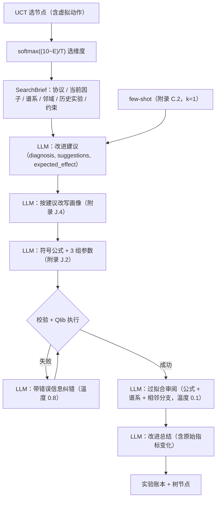

# 论文对齐与 Agent 信息流

本文说明当前实现如何对应 Shi et al.《Navigating the Alpha Jungle》（AAAI 2026，arXiv 2505.11122v2）的方法和实验设置，
以及 LLM 在每一步实际能看到什么。凡论文没有写明、由本实现自行确定的地方，都在第 4 节单独列出。

## 1. 一次扩展的信息流



- **建议生成**（论文 §4.2、附录 C.2）是单独一次调用。它读取 SearchBrief，诊断哪些改动有效、哪些无效，再给出 3 条建议和预期影响。
  建议直接替换 J.4 prompt 中的 `{refinement_suggestions}`，不再使用固定模板。
- **纠错**（Algorithm 1 第 17–20 行）：非法公式、执行失败、覆盖率不足或常数因子，错误原文都会交给纠错 prompt，
  同时附上同一结构已试过的参数。公式生成这一步也会看到最近的执行错误类型。
- **没有静默回退**：模型回答无法解析时，重试后抛出 `GenerationError`，并记入账本 `execution_failed`。
  不会用默认公式、默认 5 分或"简单包装"冒充一次搜索动作。

## 2. SearchBrief 与实验账本

SearchBrief（`llm/brief.py`）是给 LLM 的结构化文本，取代了原来整包塞进 prompt 的 JSON。

| 区块 | 内容 |
| --- | --- |
| 评估协议 | 标签（未来 h 日收益、收盘价买卖）、训练区间、各指标定义与方向、分数含义与参照集、入库标准 |
| 当前因子 | 具体公式、符号形式与参数、经济含义、原始指标、维度分数、过拟合审阅意见、本次维度及抽样概率 |
| 改进谱系 | 根→当前，每条边只出现一次：维度、改动摘要、ΔRankIC/ΔRankIR/Δ换手/Δ最大相关、总分变化、预期是否达成、入库结论 |
| 邻域 | 当前节点已尝试过的改进（避免重复），以及父节点的其他分支 |
| 历史实验 | 来自账本、按 root gene 结构相似度检索：已入库 / 未入库（附原因）/ 执行失败（按错误归类计数），同结构折叠为一行 ×N |
| 约束 | FSA 避免子结构、上一次错误 |

上下文超长时，按 `brief.LEVELS` 依次收缩低优先级区块（历史实验 → 邻域 → 较早谱系折叠为一行摘要），
协议和当前因子始终保留。prompt 中不出现 UUID、时间戳或因子矩阵。

实验账本（`mcts/experiments.py`）以只追加的 JSONL 记录每次尝试的事件：
`proposed`、`evaluated`、`execution_failed`（stage + error）、`admitted`、`rejected`（reasons）。
账本按评估协议的哈希分域，同一协议下的历史跨运行共享，作为跨树、跨运行的记忆。
数据或协议变化时修改 `data.data_revision`，就会进入新的域。

## 3. 与论文的逐项对应

| 项目 | 论文 | 实现 |
| --- | --- | --- |
| 树结构 | 多棵树，每棵 B=3、b=1（附录 B、F.1） | `MCTSSearch.run_tree`，树间共享有效因子库 |
| 根节点 | LLM 生成，附带 FSA 避免列表；第一棵树可用 f_seed | 同左 |
| UCT | Q + c·sqrt(ln N_s / N_s′)，c=1；虚拟动作的访问数=子节点数 | `MCTSNode.uct / virtual_uct`，Q 为子树最大分数（0–10） |
| 维度选择 | softmax((e_max−E)/T)，T=1 | 同左，五维均可选，不限扩展次数 |
| 维度指标 | RankIC / RankIR / 日换手率 / 最大相关 / LLM 过拟合分 | `evaluation/protocol.py` |
| 维度分数 | e = 1 − R，R 为相对排名（式 3） | 10 × (1 − 参照集中严格更优的比例) |
| 奖励 | 五维均分；回传取 max | 同左，无额外惩罚或冷启动放宽 |
| 入库 | 树结束后检查全部节点：RankIC≥0.015、RankIR≥0.3、R_RankIC≤0.95、R_RankIR≤0.95、日换手≤1.6、最大相关<0.8 | `MCTSSearch.admit`，按创建顺序逐个判定，库不设容量上限 |
| 最终因子集 | 按 RankIR 取 top 10/50/100 | `final_alphas_top{k}.csv` |
| FSA | 从有效因子库挖掘闭合 root gene，top-3，参数抽象为 t | `mcts/fsa.py`，每棵树结束后重新挖掘 |
| few-shot | Eff/Stab：剔除相关性最高的 50% 后取最优 k；Div：相关性最低 k；Turn/OR：zero-shot；k=1 | `MCTSSearch.few_shot` |
| 参数 | 符号参数，≤3 个，3 组候选择优 | 同左 |
| 算子与字段 | 附录 D 表 2；open/high/low/close/volume/vwap | `formula/dsl.py`，翻译为 Qlib 表达式；Sin/Cos/Tanh 注册为自定义算子 |
| 温度 | 画像/公式 1.0，纠错 0.8，过拟合 0.1 | `llm.temperature` |
| 标签 | 10 日 / 30 日收益，收盘价买卖 | `Ref($close, -h) / $close - 1`，`evaluation.horizon` |
| 区间 | 训练 2011–2020，测试 2021-01-01–2024-11-30 | 搜索只读训练期；测试期只在搜索结束后用于报告 |
| 股票池 | CSI300、CSI1000 | `data.universe`，按日成分（Qlib instruments 区间） |
| 搜索规模 | 1000 / 2000 / 3000 次 alpha 生成 | `mcts.total_search_count`，计数单位为树节点 |

## 4. 论文未写明、由本实现确定的部分

1. **空库时的相对排名**：式 (3) 在 N=0 时没有定义。直接取 R=0 会让所有因子四维都是 10 分，
   维度抽样几乎只选 Overfitting，搜索在冷启动阶段等于盲搜（真实运行中确实出现过）。本实现在库为空时，
   以此前测得的全部候选（树节点和参数试验）作为排名参照（`MetricPool`）；全新协议域的第一棵树，
   以根节点的 3 组参数试验为参照，并据此重算根节点分数。参照在一棵树内保持不变。
2. **R_RankIC / R_RankIR**：论文没有定义。本实现按式 (3) 的记号解释为"库中 RankIC（RankIR）严格高于该因子的比例"。
   0.95 这个界限要到库中至少有 1/(1−0.95)=20 个因子才有分辨意义：真实运行中库只有 1 个因子时，
   一个 RankIC 0.046、RankIR 0.367 的因子仅因略逊于库中唯一因子就被拒（R=1.00）。因此默认在库中因子数
   达到 `evaluation.relative_rank_min_size`（20）后才启用这两条；设为 1 即为字面实现。
3. **日换手率**：论文只说是"持仓的平均日变化"，并给出上限 1.6。本实现把因子截面去均值、按总绝对值归一为权重 w，
   取 Σ|w_t − w_{t−1}| 的日均值（范围 0–2）。
4. **最大相关**：相关系数取与库中因子日度截面 Spearman 相关均值的绝对值。库内因子自身的"最大相关"用于排名，取它与库中其他因子的最大值。
5. **标签截断**：训练期、测试期最后 h 个交易日的标签需要区间外的价格，这些日期的标签被置空。
6. **纠错与迭代上限**：论文写的是"循环直到合法"。本实现最多纠错 3 轮，单棵树最多迭代 30 次，防止无限循环；耗尽时本次迭代计入预算但不产生节点。
7. **参数择优**：3 组参数按四个数据维度的均分择优；参照集很小时均分经常相同，此时依次按原始 RankIR、RankIC 取舍。
   只对选中的那组做 LLM 过拟合审阅（每次扩展省去 2 次调用）。
8. **FSA 更新时机**：Algorithm 1 第 30 行在每个节点后更新避免列表，而 §4.5 和图 2 说从有效因子库挖掘。
   由于库只在树结束后变化，本实现在每棵树结束后重新挖掘。
9. **入库顺序**：同一棵树内按节点创建顺序判定；先入库的因子参与后续节点的最大相关检查。
10. **改进总结温度**：论文没有给出，取 0.7。改进总结和按建议改写画像两步默认通过 `llm.extra_body_by_role` 关闭 thinking：真实运行中改写画像平均耗时 174 秒、输出约 9k token，主要在重复建议生成时已做过的权衡。
11. **算子语义说明**：建议生成、过拟合审阅的 prompt 都附带算子含义（例如 Rank 是时间序列排名、必须带窗口），
    并说明五个维度分数都是越高越好。真实运行中，模型曾误以为 Rank 是横截面排名，也曾把 Overfitting 分的方向理解反。
12. **根节点上下文（对论文的补充）**：论文 J.1 只给避免列表。本实现额外告诉根节点生成器预测目标，
    并列出此前各树的根因子及其指标和入库结论，要求提出不同的经济假设。库为空时 FSA 没有内容，
    这是防止各树根节点反复落在同一假设上的唯一信息来源。

## 5. 数据与未实现部分

- 论文设置需要 2011-01-01 至 2024-11-30（含 $vwap）的数据，CSI1000 还需要对应的成分股文件。
  当前机器上的 `~/.qlib/qlib_data/cn_data` 只覆盖到 2020-09-25，只有 CSI300/CSI100，也没有 $vwap。
  `configs/live_neuroii.yaml` 是在这一限制下的冒烟配置，结果不能和论文数值比较。
- 论文后半部分的 LightGBM/MLP 组合模型和 Top-k/drop-n 交易回测尚未实现。
  `final_alphas_top{k}.csv` 目前只给出每个因子在训练期和测试期的单因子统计。

## 6. 运行输出

每次运行的 `results/<run_id>/` 包含：`run.log`（每个节点一行进度和入库结论）、`llm_calls.jsonl`
（每次模型调用的完整 prompt、回答、token 用量和耗时）、`search_trees.json`、`alpha_repository.csv`、
`final_alphas_top{k}.csv`、`run_manifest.json` 和 `checkpoint.pkl`。

## 7. 运行与测试

```powershell
python run_experiment.py --search-count 1000
python -m pytest -c mcts-llm-alpha/pyproject.toml -o addopts= -p no:cacheprovider mcts-llm-alpha/tests -q
```

离线测试使用脚本化 LLM 和合成面板，验证的是信息流和搜索不变量，不代表收益。
`legacy/` 存放已被取代的旧实现，只用于对照，可以整体删除。
